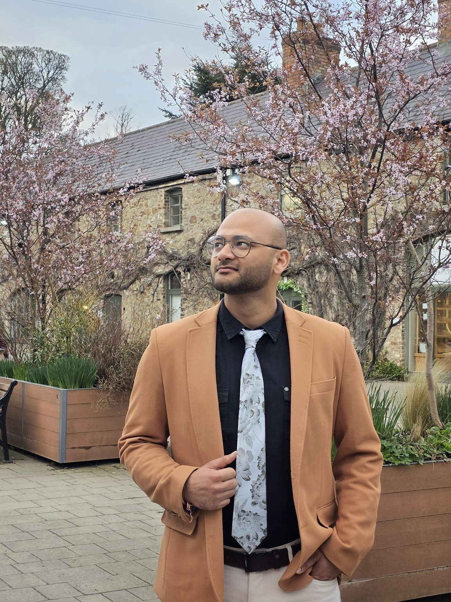

:::::: hero
::::: columns
::: {.column width="65%"}
# Shekhar Kedia

**Teaching Fellow in Applied Social Data Science**\
*Trinity College Dublin*

I am a social scientist and data analyst interested in using quantitative and computational methods to understand social and policy questions.

My work spans applied statistics, computational social science, quantitative text analysis, programme evaluation and policy research, working across textual, survey, administrative and other forms of social data.

[Research](research.qmd) · [Teaching](teaching.qmd) · [Projects](projects.qmd) · [CV](CV_ShekharKedia.pdf)
:::

::: {.column width="35%"}

:::
:::::
::::::

## About

I work at the intersection of social science and data science. My interests include quantitative methods, computational social science, quantitative text analysis, machine learning, data visualisation and the use of data to inform social and policy research.

Before moving into academic social data science, I worked in development research, programme evaluation and applied policy research. This experience continues to shape my interest in how empirical methods can be used to measure social phenomena, understand patterns in behaviour and public discourse, and generate evidence for decision-making.

## Research

My current research interests focus on the use of quantitative and computational methods to investigate social and political questions.

My work includes analysing online discourse and public sentiment, applying statistical and multivariate methods to survey data, analysing administrative and assessment data, and using computational text analysis to study political and public communication.

[Explore my research →](research.qmd)

## Teaching

I am a Teaching Fellow in Applied Social Data Science at Trinity College Dublin, teaching and supporting students across applied statistics, programming, data visualisation and research methods.

My teaching includes **Applied Statistical Analysis I and II**, **Computer Programming for Social Sciences**, **Data Visualisation for Social Scientists**, **Research Design for Social Sciences**, **Quantitative Text Analysis for Social Sciences**, and **Social Forecasting**.

[View my teaching →](teaching.qmd)

## Selected work

:::::: project-grid
::: project-card
### Public Sentiment and Hate Speech on Reddit

**MSc Dissertation · Trinity College Dublin · 2025**

Analysing immigration discourse in Ireland on Reddit using quantitative text analysis, sentiment analysis, supervised machine learning and topic modelling.

[View project →](projects.qmd)
:::

::: project-card
### Accidents Involving Cyclists and E-scooter Users

**Injuries Resolution Board · 2024**

Research examining accident characteristics, injuries and wider outcomes among cyclists and e-scooter users using personal injury compensation assessment data.

[View project →](projects.qmd)
:::

::: project-card
### MANDI: Women's Empowerment and Market Inclusion

**Grameen Foundation · 2022–23**

Research and evaluation examining women's empowerment and market inclusion within a digital agricultural market-access intervention in Eastern Uttar Pradesh.

[View project →](projects.qmd)
:::
::::::

[View all projects →](projects.qmd)

## Connect
[Email](mailto:kedias@tcd.ie) ·
[GitHub](https://github.com/ShekharKedia) · [LinkedIn](https://www.linkedin.com/in/shekharkedia/) · [Google Scholar](https://scholar.google.com/)
